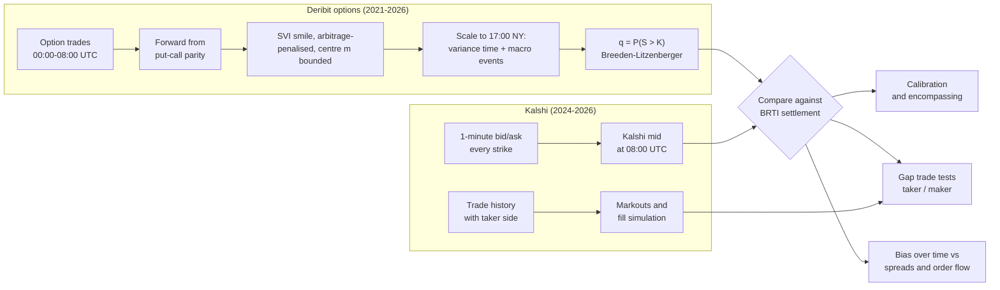

# Bitcoin options vs Kalshi: is the prediction market efficient?

**Read the results:** [full report (PDF, 11 pages)](reports/REPORT.pdf) ·
[report on GitHub](reports/REPORT.md) · [dashboard with every figure (PDF, 24 pages)](reports/dashboard.pdf)

Python · pandas · NumPy · SciPy · matplotlib · Plotly. About 7,000 lines of research code, from
data collection through to the write-up.

## The question

Kalshi lists daily contracts that pay $1 if Bitcoin is above a strike at 17:00 New York time. The
Deribit options market prices the same event, implicitly, through its volatility smile. Options
prices are *risk-neutral* probabilities: they can include a risk premium, so they need not equal
real-world odds. This project asks:

> **Are prediction-market prices efficient once you account for the risk premium in options?**

We build an option-implied probability for every Kalshi strike, then test both against what
actually happened, against each other, and in simple trading rules that pay real fees.

## The answer in five lines

1. **The options get it right.** Their 1-day probability q = P(BTC > K at 17:00 NY), from the
   08:00 UTC smile, is calibrated on Kalshi's strikes (logit slope 0.99 ± 0.04, 518 days).
2. **Kalshi has a favourite-longshot bias in 2026.** Cheap contracts are too dear and favourites too
   cheap (logit slope 1.18–1.36, 9 to 1 hours before settlement). It survives the 1¢ price-floor
   check; before 2026 it was mostly that floor.
3. **Kalshi is flatter than the options by 2–4¢, but just as informative.** The Brier scores are
   equal. With fresh option data the two carry similar information.
4. **The gap can't be traded.**
   - Taker rules don't beat fees and the spread in the 2026 holdout.
   - Maker profits vanish once fills are simulated from Kalshi's trade history: orders fill
     mainly when they are about to lose.
5. **So Kalshi is efficient up to its costs.** The options' risk premium is too small at a 1-day
   horizon to explain the bias. The bias coincides with more takers buying longshots in 2026, a
   suggestive link but not a significant one.


## Method



**Checks built in:**
- Every forecast uses only data before 08:00 UTC.
- 2026 is a holdout: rules and thresholds were fixed on earlier data.
- Standard errors are clustered by settlement day, since all strikes on a day share one outcome.

**Data:** 22.7M Deribit option trades (2021–2026), Kalshi 1-minute quotes for 780 settlement days
and 2.5M Kalshi trades, Binance 1-minute BTC candles, and CPI/NFP/FOMC release times.

## Figures

| | |
|---|---|
|  **1.** From option trades to a smile to q(K), one day |  **2.** The 1-day option forecasts are calibrated (PIT, 1,869 days) |
|  **3.** Kalshi's favourite-longshot bias and the price-floor check |  **4.** Kalshi vs the option-implied q on the same contracts |
|  **5.** Which price carries the information: stale vs fresh smiles |  **6.** Taker and maker P&L after fees, with simulated fills |
|  **7.** Markouts: what resting orders earn after a fill |  **8.** The bias over time against spreads, flow and volume |

Supporting results for each step, with tables and more figures, are in the folders below.

## Repository layout

| | |
|---|---|
| [reports/REPORT.md](reports/REPORT.md), [REPORT.pdf](reports/REPORT.pdf) | the write-up, with figures |
| [reports/dashboard.pdf](reports/dashboard.pdf) | every project figure in one document (`dashboard.html` is the interactive version: download and open it in a browser) |
| [reports/pm/](reports/pm/) | Kalshi results: calibration, robustness, vs options, trade tests, markouts, bias over time |
| [reports/short_horizon/](reports/short_horizon/), [reports/intraday/](reports/intraday/) | the 1-day option forecasts and the intraday variance profile behind them |
| [reports/phase2/](reports/phase2/SUMMARY.md), [reports/phase3/](reports/phase3/SUMMARY.md) | earlier 30-day forecasts: DVOL, full smile, robustness |
| [src/](src/) | all code; [src/models/smile.py](src/models/smile.py) has the SVI fit and Breeden-Litzenberger densities |
| [docs/OPERATIONS.md](docs/OPERATIONS.md) | data layout, live collection, scheduling, conventions, data limitations |
| [docs/ROADMAP_PRICING_KERNEL.md](docs/ROADMAP_PRICING_KERNEL.md) | next step: from risk-neutral q to real-world p |

Each results folder has a `RESULTS.md` (or `SUMMARY.md`) with every table, plus the CSVs.

## How to run

Python 3.11+ (tested on 3.13). Run every module from the project root.

```bash
python -m venv .venv
.venv/Scripts/python -m pip install -r requirements.txt     # Mac/Linux: .venv/bin/python
```

The raw data (about 2.3 GB) is not in the repository. Everything except the live snapshots can be
rebuilt from free public APIs with the first three steps below; the full option-trade download
takes about two days. Derived results (CSV and parquet) are committed under `reports/`.

| Step | Command | Output |
|---|---|---|
| Option trades, prices, DVOL | `python -m src.deribit_options 2021-01-01 <month>`, `src.deribit_prices`, `src.deribit_dvol` | `data/raw/` |
| Binance 1-minute history | `python -m src.binance_bulk` | `data/raw/binance_1m/` |
| Kalshi / Polymarket history | `python -m src.pm_backfill`, `python -m src.pm_kalshi_trades` | `data/raw/pm_history/` |
| 30-day option forecasts | `python -m src.phase2`, `python -m src.phase3` | `reports/phase2/`, `reports/phase3/` |
| 1-day option forecasts | `python -m src.intraday_vol`, `python -m src.short_horizon` | `reports/short_horizon/` |
| Kalshi calibration and robustness | `python -m src.pm_kalshi_calib`, `python -m src.pm_kalshi_robust` | `reports/pm/` |
| Kalshi vs options, trade tests | `python -m src.pm_kalshi_options`, `src.pm_kalshi_gap_trade`, `src.pm_kalshi_markout` | `reports/pm/` |
| Bias over time | `python -m src.pm_kalshi_bias_time` | `reports/pm/kalshi_bias_time/` |
| Report figures, PDF, dashboard | `python -m src.report_figures`, `src.report_pdf`, `src.dashboard` | `reports/` |
| Live collection | `python -m src.snapshot` (every 10 min), `src.resolutions` (daily), `src.paper_trade` (08:07 UTC) | `data/raw/snapshots/`, `data/processed/paper_trades/` |

`src.report_pdf` needs Chrome, Chromium or Edge installed. Scheduling, data layout, conventions
and known data limitations are in [docs/OPERATIONS.md](docs/OPERATIONS.md).

## Data sources

All free and public, with no API key: [Deribit](https://docs.deribit.com) (options, index, DVOL),
[Kalshi](https://docs.kalshi.com) (markets, candles, trades),
[Polymarket](https://docs.polymarket.com), [Binance](https://data.binance.vision) (1-minute
BTC/USDT), plus [BLS](https://www.bls.gov) and the [Federal Reserve](https://www.federalreserve.gov)
for macro release times.

Research only: the paper-trading log never sends orders.
