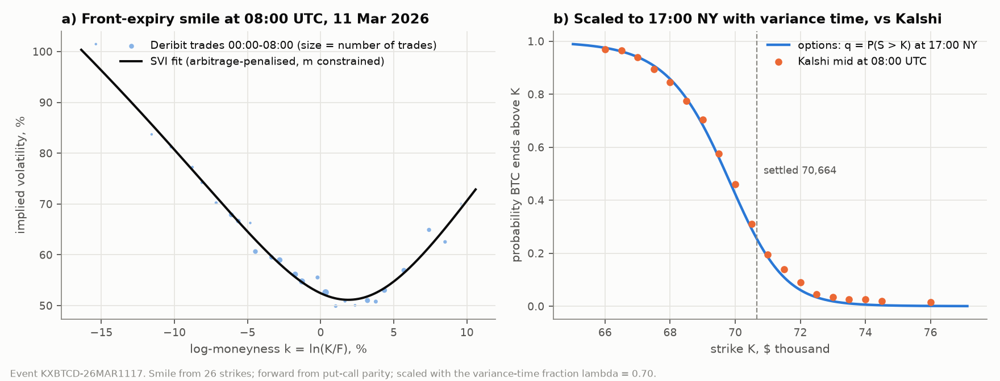
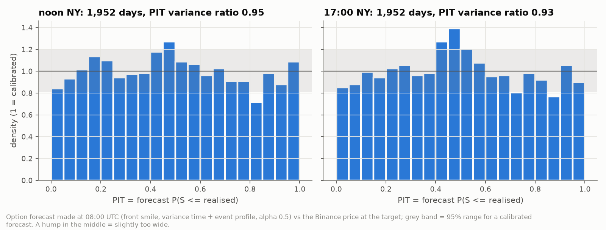
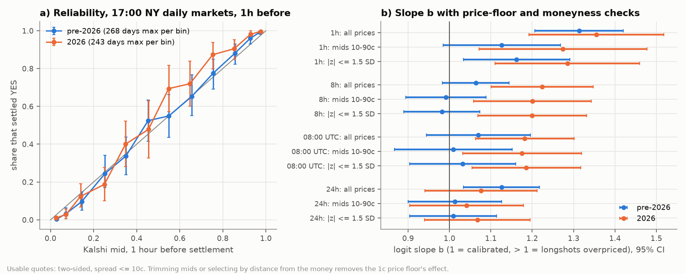
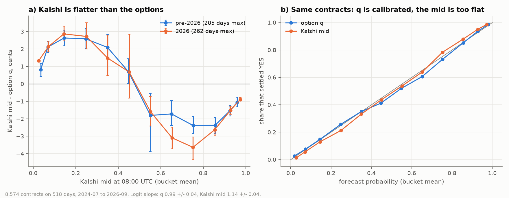
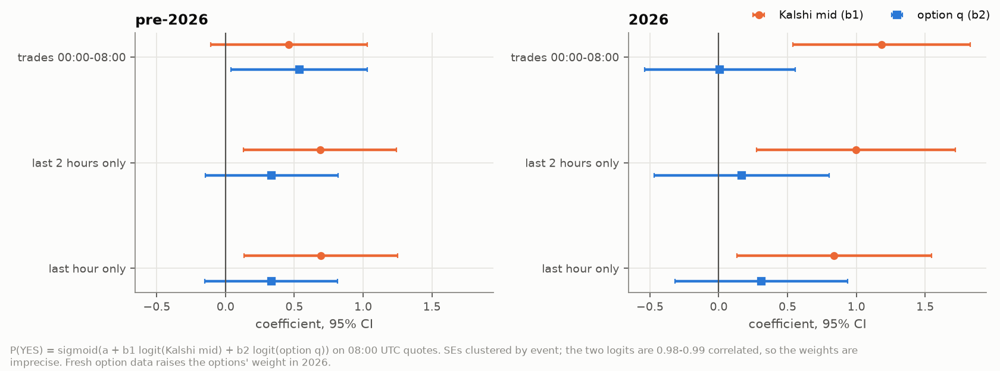
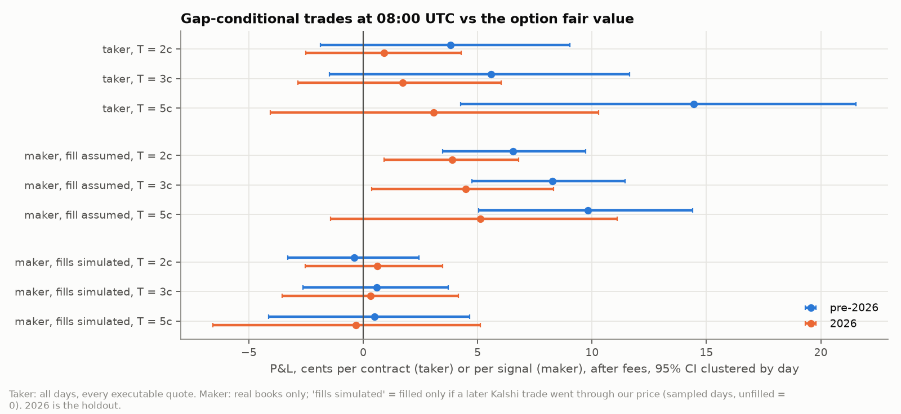
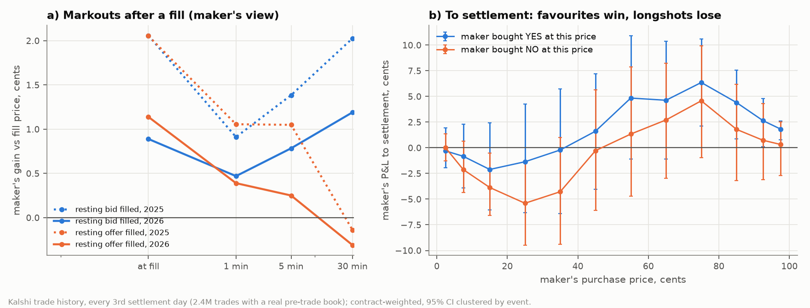
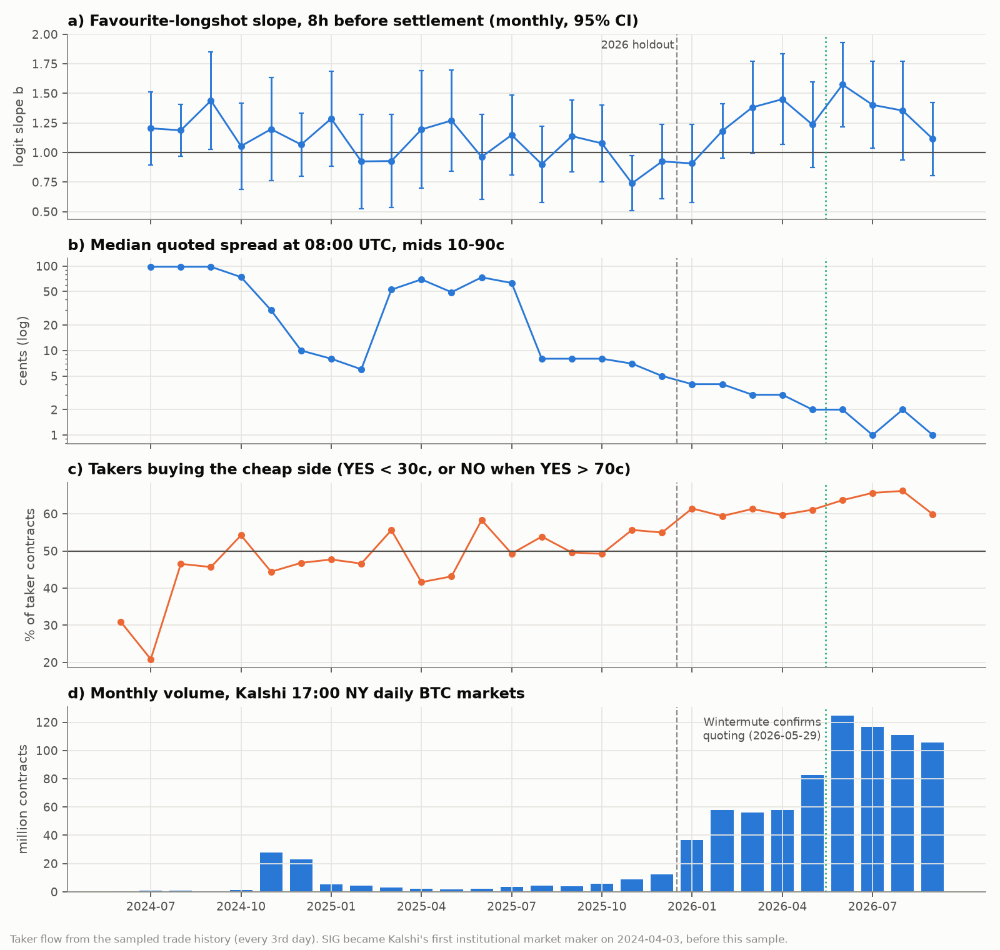

# Bitcoin options vs Kalshi: are prediction markets efficient once you account for the options' risk premium?

*Draft, 2026-10-03. Numbers are from the scripts named in each section; figures from
`python -m src.report_figures`.*

## 1. Question

Kalshi, a US-regulated exchange, lists a contract each day that pays $1 if Bitcoin's price is above
a strike K at 17:00 New York time. There are about 15–80 strikes per day. The Deribit options
market prices the same event implicitly: a smile of implied volatilities at the nearest expiry
contains a full probability distribution for Bitcoin's price.

Those option probabilities are **risk-neutral** (q). They are the probabilities that make option
prices fair, and can differ from real-world odds (p) by a risk premium: for example, if
investors pay up for crash insurance.

**Our question:** is Kalshi's price an efficient forecast once that premium is accounted for? We
answer it in four steps:
1. Build the option-implied q for every Kalshi strike, using only information available at
   08:00 UTC.
2. Test Kalshi's prices and q against the settlement outcome, and against each other.
3. Ask whether the difference can be traded after fees, as a taker or as a market maker.
4. Ask what drives Kalshi's mispricing over time.

## 2. Data

| Source | Content | Period | Use |
|---|---|---|---|
| Deribit (history.deribit.com) | every BTC option trade: price, implied vol, index | 2021-01 to 2026-09 | option smiles |
| Binance (data.binance.vision) | BTC/USDT 1-minute candles | 2021-01 to 2026-08 | intraday variance profile; outcomes for the 30-day work |
| Kalshi API | KXBTCD 17:00 NY daily markets: 1-minute bid/ask, open interest, volume, result, BRTI settlement value | 2024-06 to 2026-10 (780 days) | the prediction market |
| Kalshi API | trade history with the taker's side, every 3rd settlement day | 260 days, 2.5M trades | markouts, fill simulation, order flow |
| BLS, Federal Reserve | CPI, NFP (08:30 ET), FOMC (14:00 ET) release times | 2021–2026 | event-day variance |
| Live snapshots | Deribit chain + Kalshi/Polymarket books every 10 min | from 2026-09-30 | capacity, paper trading |

**Kalshi settles on the BRTI**: CF Benchmarks' Bitcoin reference rate, averaged over the 60 seconds
before the close.
- **Basis.** At settlement the BRTI and Deribit's index differ by a median of +0.1 bp (SD 5 bp),
  so the basis between them is immaterial.
- **The 12:00 NY series is excluded.** Those markets open at 11:00, so they're hourly markets with
  no usable quote at our horizons.
- **Kalshi data cleaning.**
  - A quote is *usable* only if it is two-sided with a spread of at most 10¢.
  - Before 2026, 40% of 08:00 books were 1¢/99¢ placeholders, whose midpoint carries no
    information.

**Effective sample size.** All strikes on a day settle on the same price, so they are not
independent. Throughout, the effective sample size is the number of **settlement days**, and
standard errors are clustered by day.

## 3. The options model

### 3.1 From trades to a smile

- **Trades.** For each day we pool Deribit option trades from 00:00 to 08:00 UTC, after
  cleaning. We drop zero or absurd implied vols, combo legs and options within a day of expiry:
  23% of trades on a typical day.
- **Forward.** Deribit options are *inverse*, quoted in BTC. The forward F comes from put-call
  parity on calls and puts traded close together: F = K / (1 − (c − p)), with c and p in BTC.
  Deribit prices carry no discounting: the implied discount factor is 1 to within 1 bp at all
  tenors.
- **Smile.** The front expiry (normally 08:00 UTC the next day) is fitted with Gatheral's SVI for
  total variance w(k) = σ²T, with k = ln(K/F):

      w(k) = a + b · ( ρ (k − m) + √((k − m)² + s²) )

  - The fit is a robust least-squares on trade implied vols, weighted by the number of trades.
  - It is **penalised towards no arbitrage** over ±6 standard deviations:
    - butterfly: Gatheral's g(k) ≥ 0, i.e. a non-negative density;
    - vertical spread: 0 ≤ −∂C/∂K ≤ 1.
- **Centre m.** For the short-dated front smile, m is bounded to ±1 ATM standard deviation and to
  the traded strike range.
  - Few strikes leave m poorly identified: on 66% of days the free fit put m beyond 1 SD.
  - The free fits caused almost all arbitrage violations after scaling.
  - Bounding m cut calendar violations from 228–262 to 2–4 per variant, and butterfly violations
    from 168 to 18.
  - It cost 0.06 vol points of fit error (median 1.61 → 1.67).

### 3.2 From the smile to a 1-day probability

**Density.** Black-76 prices on a fine strike grid (±16 SD), differentiated twice
(Breeden-Litzenberger), give the density of S at the front expiry; q(K) = −∂C/∂K.

**Scaling to 17:00 New York.** The front expiry is 08:00 UTC the next day, but Kalshi settles at
17:00 NY, 9–14 hours earlier. We scale the smile in total variance:

    w_s(k) = λ · w₁(k / λ^α),     λ = τ(08:00 → 17:00 NY) / τ(08:00 → expiry)

- **Variance time τ, not clock time.** τ is the expected share of the day's variance falling in
  each minute. It comes from the intraday profile of squared 1-minute Binance returns.
  - The profile is fitted on the trailing 365 days, separately for weekdays and weekends and by US
    daylight-saving regime.
  - Weekends carry about 0.56 of a weekday's variance, falling from 0.73 in 2021.
  - From 08:00 to 17:00 UTC on a weekday, variance time is 0.44 of a day against 0.375 in clock time.
- **Event days.** On CPI, NFP and FOMC days, the release minute adds excess variance, estimated
  from earlier events only:
  - CPI +0.26 of a normal day, NFP +0.14, FOMC +0.62;
  - the first 5 minutes after FOMC run at 29× normal.
  - Events move λ, not the total variance, which the front smile already prices.
- **Smile shape: α = 0.5.** This keeps implied vol fixed in standardised moneyness and preserves
  the no-butterfly condition analytically. An α fitted daily from the 1-day vs 1-week smiles has
  a median of 0.50 (IQR 0.45–0.55) and gives the same forecasts.
- **No look-ahead.** Option trades before 08:00, profiles from the trailing year, event
  excess from earlier events, α from earlier days.

*Figure 1. One day, 11 March 2026.*
- *a) The trades and the fitted front smile.*
- *b) The scaled q(K) for 17:00 NY, with Kalshi's mids at 08:00 UTC.*

### 3.3 Validation

We forecast the Binance price at noon and 17:00 NY on 1,869 days (2021-06 to 2026-08) and score
the full distributions.

- **Variance time beats clock time.** The log score improves by 0.010 ± 0.003 at noon and
  0.006 ± 0.003 at 17:00.
- **The event profile helps on event days at noon**: +0.020 ± 0.013, not significant.
- **Tails are right.** 4.1–4.9% of outcomes fall below the 5th percentile and 4.6–5.7% above the
  95th.
- **The distributions are slightly too wide** (Figure 2): the PIT variance ratio is 0.93–0.95,
  where 1 is right. That is consistent with a small variance risk premium in short-dated options.

*Figure 2. Calibration of the 1-day option forecasts.*
- *A flat histogram means calibrated.*
- *The central hump means the forecast is slightly too wide.*

**At 30 days (phases 2–3), the risk premium is visible but statistically weak.**
- DVOL averaged 60% against 51% realised volatility.
- The full-smile forecast's PIT variance ratio is 1.02.
- Options under-predicted rallies (8.8% of outcomes above the 95th percentile). But that is
  concentrated in 2023–24 and not significant with overlapping-window corrections (95% CI
  4.5–14.0%).
- With about 64 independent 30-day windows, the 30-day premium can't be pinned down. That is one
  reason to move to daily events.

## 4. Is Kalshi calibrated?

For each 17:00 NY market we take the usable mid at four quote times: 24h, 8h and 1h before
settlement, and 08:00 UTC (9 hours before, aligned with the options). We fit

    P(YES) = sigmoid(a + b · logit(mid))

with standard errors clustered by event, estimated before 2026 and on 2026 as a holdout.
- **b = 1, a = 0** means calibrated.
- **b > 1** is the **favourite-longshot bias**: true probabilities are more extreme than the
  price, so cheap contracts are overpriced and expensive ones underpriced.

| Quote time | b before 2026 (days) | b in 2026 (days) |
|---|---|---|
| 24h | 1.13 ± 0.05 (407) | 1.08 ± 0.07 (268) |
| 08:00 UTC | 1.07 ± 0.06 (254) | **1.18 ± 0.06** (275) |
| 8h | 1.06 ± 0.04 (484) | **1.22 ± 0.06** (275) |
| 1h | **1.31 ± 0.05** (407) | **1.36 ± 0.08** (274) |

**Intercept.** a is about 0 everywhere: YES is not systematically over- or underpriced.

**The price floor.** Kalshi prices sit on a 1¢ grid, so a contract whose true probability is 0.2%
still shows a mid of about 1.5¢. Logit(mid) is mismeasured near 0 and 1, and that alone can push
b above 1. We check two ways (Figure 3b):
- **Trimming prices:** refit without mids below 5¢ or above 95¢, and below 10¢ or above 90¢.
- **Selecting by distance from the money:** z = ln(S/K) / (σ√τ), so the selection doesn't depend
  on the quote itself.

The result:
- **The 2026 bias at 1h, 8h and 08:00 UTC survives** every cut: b of 1.17–1.44 on the trimmed or
  |z|-selected samples.
- The floor explains at most a quarter of it.
- **The pre-2026 and 24h slopes are mostly the floor:** trimmed, b ≈ 1.0.

*Figure 3.*
- *a) Reliability of the 1h-before mid.*
- *b) The slope b under the price-floor and moneyness checks.*

**Out of sample, recalibrating barely helps.** Applying the pre-2026 fit to 2026 improves the
Brier score (mean squared error of the probability) only at 1h: −0.0011, CI [−0.0021, −0.0001],
about 2%. Elsewhere the change is within ±0.0002.

## 5. Kalshi vs the options

At 08:00 UTC we compute q for every quoted strike (8,574 contracts on 518 days, 2024-07 to 2026-09).

**a) The gap.** The Kalshi mid and q are 0.99 correlated, and the average gap is 0.0¢. But it is
systematic by price (Figure 4a):
- Kalshi is **above** q by 1.3–2.9¢ for contracts under 30¢.
- Kalshi is **below** q by 1.5–3.6¢ for contracts between 55¢ and 90¢.
- Both periods show the same shape.
- **Kalshi's implied distribution is wider than the options'.**

**b) Who is right? The options.** On the same contracts, q's logit slope is 0.985 ± 0.04 and the
Kalshi mid's is 1.14 ± 0.04 (Figure 4b).

*Figure 4.*
- *a) Kalshi mid minus option q by price bucket.*
- *b) Reliability of q and of the Kalshi mid on the same contracts.*

**c) Information: the encompassing regression.**

    P(YES) = sigmoid(a + b₁ · logit(mid) + b₂ · logit(q))

If one price contains all the useful information, the other's coefficient is zero.
- **2026, usual 8-hour smile:** b₁ = 1.14 ± 0.33 and b₂ = 0.04 ± 0.28. **Kalshi
  encompasses the options.**
- **Before 2026:** the weights split roughly evenly (0.46 / 0.54).

**Staleness check.** The options are handicapped: the smile pools eight hours of trades, while the
Kalshi quote is live. So we rebuilt q from only the **last one or two hours** of trades, with the
data gates loosened and every trade re-centred on the 08:00 forward.
- **Coverage and fit:** this works on 752 and 756 of 756 days, with a median of 106 trades in the
  last hour. The fit is better: 1.34 vs 1.60 vol points.
- **The options' 2026 weight rises** from 0.04 to 0.17 (2h) and 0.31 (1h), while Kalshi's
  falls from 1.18 to 0.84 (Figure 5). Kalshi stays significant and the options don't, but the
  logits are 0.99 correlated, so the split is imprecise.
- **Fresh q is also more accurate:** 2026 Brier 0.0809, against 0.0814 for the 8h q
  (difference −0.0005, CI [−0.0010, −0.0000]) and 0.0812 for the Kalshi mid (not significant).

*Figure 5. Encompassing weights with stale (8h) and fresh (2h, 1h) option smiles.*

**d) Accuracy.** Over all 518 days the Brier scores are equal: 0.0962 for the mid and 0.0962 for q.
The 50/50 blend is 0.0959, slightly better but not significant.

**Interpretation for the risk-premium hypothesis.** If Kalshi simply inherited the options'
risk-neutral prices, then the mid would equal q, both would be miscalibrated the same way, and the
options would carry the information. None of that holds:
- **The options' risk premium is too small at this horizon** to show on these strikes: q is
  calibrated.
- **Kalshi adds its own flattening**, the favourite-longshot bias.
- **Kalshi ranks outcomes as well as the options**, and adds nothing beyond fresh option data.

## 6. Can the gap be traded?

### 6.1 Taker rules

At 08:00 UTC we buy only when the option fair value beats Kalshi's executable price by more than
the fee plus a threshold T. T is fixed in advance at 2, 3 and 5¢; nothing is tuned on 2026.
- **Buy YES** at the ask if q − ask − fee > T.
- **Buy NO** at 1 − bid if (1 − q) − (1 − bid) − fee > T.
- **Fee** is Kalshi's quadratic taker fee, ceil(0.07 · C · P(1 − P)), for C = 100 contracts.

**What it trades:** mostly the favourite side, at an average price of 65–75¢, with hit rates of
72–81%.

**2026 holdout: no significant edge** at any threshold (Figure 6):
- T = 2¢: +0.9¢ per contract [−2.5, +4.3] on 890 trades over 180 days.
- T = 3¢: +1.7¢ [−2.9, +6.0].
- T = 5¢: +3.1¢ [−4.1, +10.3].
- Maximum drawdowns are $1,100–1,700 per 100 contracts, against totals of about $800–1,000.

**Before 2026**, only T = 5¢ is significant: +14.4¢ [+4.3, +21.5] on 59 days of wide books.

### 6.2 Maker rules and the fill problem

**The naive version.** Rest the same orders at the bid (or offer) instead of paying the spread.
Kalshi charges no maker fee on these series. If every order filled at its price, this would earn
+3.9 to +5.1¢ per signal in 2026 (significant).

**The realistic version.** Using Kalshi's trade history, we fill an order only if a later taker
trade went **through** our price before the close, which fills even an order at the back of the
queue. Unfilled orders earn nothing.
- **Fill rate:** about 75% in 2026.
- **The edge disappears:** +0.6, +0.3 and −0.3¢ per signal for T = 2, 3 and 5¢, all
  insignificant. Before 2026 it is the same (−0.4 to +0.6¢).
- **Why:** the quarter of orders that never fill are disproportionately the winners. When the
  favourite rallies, the price moves away from your bid, so you are filled mostly when the
  favourite is about to lose. This is adverse selection through *which days fill*, which a
  markout cannot see.

*Figure 6. Taker and maker P&L with 95% CIs. "Fills simulated" uses Kalshi's trade history
(sampled days).*

### 6.3 Markouts

Figure 7a shows what resting orders earn after a fill, in the maker's terms (2.4M trades with a
real book before them):
- **Spreads earned halved in 2026**, from about 2¢ to 1¢.
- **Takers who buy YES are informed:** the mid moves 0.7–1.1¢ against the maker within five
  minutes, every year.
- **Takers who sell YES carried no short-term information in 2026** (−0.1¢).

**At settlement (Figure 7b)** the favourite-longshot bias appears as a transfer:
- Makers who bought favourites at 70–100¢ gain +1.8 to +6.4¢ per contract.
- Makers who bought longshot NO at 10–30¢ lose 3.9–5.4¢.

*Figure 7.*
- *a) The maker's gain against the fill price, at the fill and 1, 5 and 30 minutes later.*
- *b) The maker's P&L to settlement by purchase price.*

**The sample is representative.** The sampled days are a third of all days and of the volume each
year, with the same weekend mix, and the sampling is by calendar order.

## 7. Bias over time and market structure

**The market changed completely over the sample** (Figure 8):
- **Volume:** 17:00 NY volume rose from 2–9 million contracts a month in 2025 to 36–125 million
  in 2026. Open interest per event rose from tens of thousands to about 500,000.
- **Spreads:** the median quoted spread at 08:00 fell from placeholder books (about 98¢) in 2024,
  to under 10¢ from August 2025, to 1–2¢ by mid-2026.
- **The bias:** the 8h slope rose from about 1.0 in late 2025 to 1.2–1.6 from March 2026.

**Spreads don't explain the bias.** Spreads collapsed while the bias grew, the opposite of what a
spread explanation predicts.

**Order flow fits the timing.**
- The share of taker volume that buys the cheap side was about 50% through 2025, and 59–66% in
  every month of 2026.
- But the formal tests are null:
  - **monthly:** bias on flow with a time trend, |t| < 1.6;
  - **daily:** the 08:00 gap on that morning's flow before 08:00, R² ≤ 3%.
- With about nine months of 2026, demand pressure is a hypothesis, not a finding.

**Market makers.**
- Susquehanna (SIG) became Kalshi's first institutional market maker on 3 April 2024, before
  our sample.
- Wintermute confirmed on 29 May 2026 that it quotes Kalshi event contracts; nothing changes
  visibly around that date.
- Kalshi lists one designated liquidity provider for crypto hourly and daily markets but
  publishes no start date.
- The data date professional quoting to about **August 2025**, when spreads fell from about 60¢ to
  8¢.
- Historical order-book depth is not available, only the live snapshots since 2026-09-30.

*Figure 8. Monthly favourite-longshot slope, quoted spread, taker flow and volume.*

## 8. Limitations

- **One market, about two years.** The 2026 holdout has about 275 days. Some design choices were
  made after seeing 2026 data: the 10¢ spread cap, the bound on m, and adding the 08:00 UTC quote
  time. The roadmap C parameters will be estimated without 2026.
- **The option smile is pooled over eight hours.** Fresh smiles help (Section 5). Weekends are
  thin: the backtest skips days without enough call/put pairs for the parity forward. The live
  log then falls back to Deribit's own forward.
- **Kalshi data is minute-level.** Candles give the quote at the end of each minute, with no
  historical depth. Markouts at 1 minute are really 1–2 minutes.
- **The fill simulation is simplified:**
  - orders rest at the 08:00 price all day, with no cancel or repricing;
  - "through" ignores the queue, which is conservative;
  - only one size (100 contracts);
  - trade history covers every third day.
- **Fees and incentives.** We use Kalshi's quadratic taker fee and zero maker fee. Kalshi's
  Volume Incentive Program (paying for volume, March 2023 to October 2026) and its
  liquidity-provider payments are ignored. They could make market making profitable where our
  numbers say it isn't.
- **Many tests.** We report every cell, and a single z ≈ 2 among them should not be over-read.
- **Real-world p is not estimated yet.** "The options are calibrated" is a statement about q on
  this sample. The risk-neutral to real-world adjustment is roadmap C.

## 9. Extensions

- **Polymarket replication.** About 850 daily and weekly "above K" and range events are already
  backfilled, as 1-minute mids settled on the Binance noon price. Calibration and the comparison
  with q can be repeated. With mids only, there is no trade test.
- **Roadmap C: from q to real-world p.** An exponential-quadratic pricing kernel,
  p(x) ∝ q(x) · exp(γx + δx²), fitted by rolling maximum likelihood on the 1-day distributions.
  The δ-only (variance premium) model is primary, with a GARCH-t benchmark, 2021–2026 Binance
  history and a 2026 holdout. Plan in [phase_c/PLAN.md](phase_c/PLAN.md).
- **Lead-lag.** Within the day, does Kalshi or the options market move first after a BTC move?
- **Hourly markets.** Kalshi's 12:00 NY series is hourly; at a 1-hour horizon the price floor
  and order flow may matter more.
- **Paper trading.** The live log (src/paper_trade.py) records the gap rule's signals at 08:00
  UTC every day, with best-level sizes and fills from Kalshi's trade history. It will show
  whether the backtest's conclusions hold out of sample.
